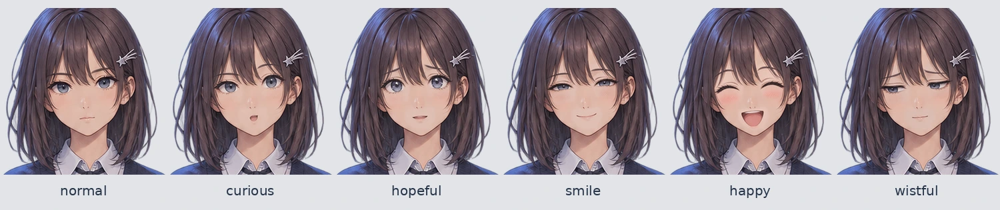

# アオイの立ち絵制作仕様

「星の帰り道」で使用する暫定デザイン。シナリオで描かれるのは、アオイが閉館前の図書室で顔見知りの主人公を屋上へ誘うことと、その返答を受けた会話である。制服、配色、髪留め、体格は今回の作画上の選択で、年齢・学年・身長は未設定。



| ID | 作画上の差 | ゲーム中のタイミング |
| --- | --- | --- |
| normal | 唇を閉じ、まっすぐ相手を見る | 屋上に出て、夜風を感じる地の文 |
| curious | 眉を片側だけ上げ、小さく口を開く | 図書室で「まだ帰らないの？」 |
| hopeful | 視線を相手に戻し、目を見開いて頬を薄く染める | 屋上へ誘う台詞から選択中まで |
| smile | 目を細め、唇を閉じて口角を上げる | 流れ星が横切る場面 |
| happy | 目を弧にして閉じ、口を開けて笑う | 屋上で感謝を伝える台詞 |
| wistful | 視線をわずかに落とし、眉の内側を上げる | 図書室で別れを告げ、次の地の文で退場 |

## 原画

髪は肩に届く青みのあるダークブラウン。分けた前髪の間から青灰色の目が見える。本人の左こめかみ（画面右）に小さな銀色の流れ星の髪留めを付ける。白いシャツ、細い濃色のリボン、紺のカーディガン、膝付近までのグレーのプリーツスカート、紺の靴下、焦げ茶のローファーを着用。正面に立ち、腕は体の両脇に下ろし、本人の右足を少し前に置く。左上からの柔らかい青い反射光と温かい肌色を基調にする。

[全身プレビュー](previews/full-body.webp) · [透過境界の確認](previews/alpha.webp) · [透過マスターPNG](normal.png)

## 表情を追加する

1. 基準は `normal.png`（1536×2304、RGBA）。生成した全身原画は1024×1536で、余白を設けてリサンプリングした。新しい表情を作るときはこのマスターを複製する。
2. 顔の輪郭、前髪、鼻、髪留めを固定し、眉・まぶた・瞳・口・頬の範囲だけを編集する。髪や制服の色調補正も全身に適用しない。今回の5差分は原画から切り出した同一の顔を参照編集し、目元・頬と口のマスク内だけを合成した。
3. マスター座標の矩形 `(640, 199)–(865, 395)` を切り出す。左上を含み、右下を含まない225×196pxのRGBA PNGとして `expressions/<id>.png` に置く。矩形内の未編集部分とアルファはマスターから引き継ぐ。
4. Pillow 13（WebP対応）を用意し、リポジトリのルートで以下を実行する。スクリプトは各PNGを同じ座標に貼り、1024×1536に縮小して可逆WebPで書き出す。透明画素のRGBをゼロにし、再デコードしたRGBAが書き出し前と一致することを検査する。

   ```sh
   python artwork/characters/aoi/export.py
   bun run build:web
   ```

5. `js/script.js` の `a.sprites` にファイル名を登録し、対象の台詞の直前に `show character a <id>` を置く。画像を同名で差し替えたリリースでは、キャッシュ優先で配信されるため `service-worker.js` のキャッシュ版を更新して再ビルドする。制作ファイルは `build/web` の対象外。

## 実装と画面表示

キャラクターIDは `a`、画像ディレクトリは `assets/characters/aoi/`。立ち絵は画面の左から33%の位置に置き、画面高に合わせて膝から下を画面外に送る。画像はポインターイベントを受け取らない。初登場と退場に280msのフェードを使用する。

`js/character-cues.js` はシナリオ中の人物の表示・非表示命令を各ステップに対応付ける。台詞や選択肢の番号を維持し、前進・巻き戻し・ロードの際にMonogatari本体の表示アクションを実行する。同じ人物・表情の間は画像要素を使い続ける。別の人物を追加する場合も `characters` にそのID、`directory`、`sprites` を登録し、同じ表示・非表示命令を使える。

[人物の登録](https://monogatari.io/v2/building-blocks/characters) · [表示命令](https://monogatari.io/v2/script-actions/characters) · [非表示命令](https://monogatari.io/v2/script-actions/hide-character)

## ゲーム画面

実際のゲームを操作して撮影した。背景には `main` に取り込まれた背景PR #3のWebPを使用している。

[夕暮れの図書室](previews/library-twilight.webp) · [屋上](previews/rooftop-night.webp) · [夜の図書室](previews/library-night.webp) · [横向きモバイルの選択肢](previews/landscape-choice.webp)
